<div align="center">


<br>

[](https://github.com/ashfordeOU/monorail/releases/latest)

[](https://github.com/ashfordeOU/monorail/releases/latest)


[](https://github.com/ashfordeOU/monorail/actions/workflows/ci.yml)

[Install](#install) · [What's new](#new-in-17) · [Getting started](#getting-started) · [Shortcuts](#keyboard-shortcuts) · [Automation](#automation) · [FAQ](#faq) · [Build from source](#build-from-source)

</div>

---

**Monorail by Ashforde®** is a scrolling window manager for your Mac. **Version 1.5 is here:** you can ask it questions, search Settings, and install it with Homebrew. **1.4:** It keeps floating windows in view, shows your usage in About, and speaks nine languages. 1.3 added Stay Awake, Amphetamine-style, and 1.2 added this: you can tell it what you want in plain words, it learns how you work, it tells you when an AI agent needs you, it keeps private windows out of screen shares, and it comes in 27 themes.

Grid tilers squeeze every new window into the space that's already there.
**Monorail does the opposite.** Each window is a column on a horizontal strip
that runs past the edges of your display. Open a window and it slides in next
to the one you're using; everything else keeps its size. Move focus and the
strip glides just far enough to bring the window into view.

<p align="center">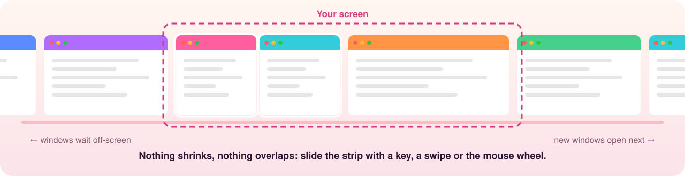</p>

### Up and running in a minute

1. **Install:** `curl -fsSL https://raw.githubusercontent.com/ashfordeOU/monorail/main/scripts/install.sh | bash`, or [download the DMG](https://github.com/ashfordeOU/monorail/releases/latest).
2. **Allow Accessibility** when Monorail asks. The welcome tour shows you where.
3. **Move around:**
   - <kbd>⌃⌥←</kbd> <kbd>⌃⌥→</kbd> slides the strip.
   - <kbd>⌃⌥O</kbd> opens the overview.
   - <kbd>⌃⌥/</kbd> opens the command palette, where you can just type what you want.
   - <kbd>esc</kbd> closes any Monorail panel.

### Why people switch

- **Nothing shrinks.** New windows join the strip instead of squeezing the rest, so your editor stays the size you left it.
- **It understands you.** Plain sentences, intents and habits it learns, all on your Mac, with no cloud and no account.
- **Made for today's work.** It tells you when an AI coding agent is waiting, keeps private windows out of screen shares, and shares exactly one slide in a call.
- **Mouse, keyboard or neither.** Use the scroll wheel, trackpad swipes, a slider bar, vim keys, a MIDI pad, a game controller or your phone.
- **It never loses a window.** Undo and a timeline, and restore after a restart, a crash, sleep or unplugging a display.
- **Free**, source-available (FSL), native Swift, and a universal app.

## A tour

**The overview** (<kbd>⌃⌥O</kbd>, or <kbd>⌥</kbd> + pinch): every workspace and slide on one colourful canvas. Drag windows between slides, displays and workspaces, rename workspaces in place, close windows by dropping them on the bin.

<p align="center">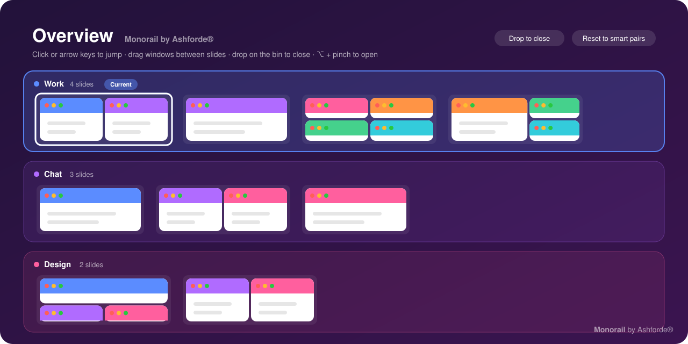</p>

**The slider** glides in as the strip moves. Hover a slide for a live preview, drag to slide everything along, hold <kbd>⌥</kbd> to peek.

<p align="center"></p>

**Your choice:** keep the slider bar, or keep your screen clean and use just the menu bar icon, whose panel hangs right under it.

<p align="center">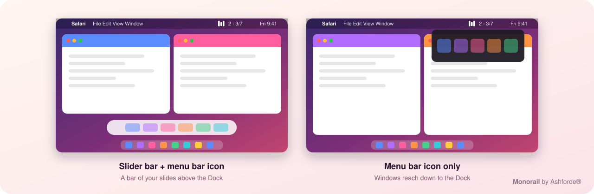</p>
<p align="center">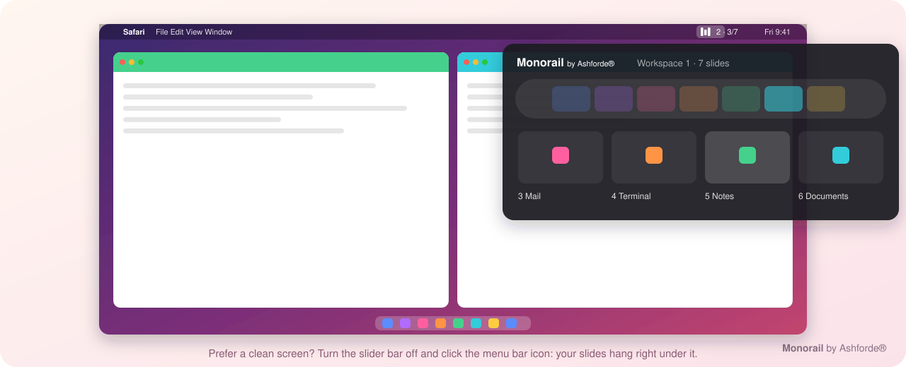</p>

**Command palette** (<kbd>⌃⌥/</kbd>): type what you want.

<p align="center">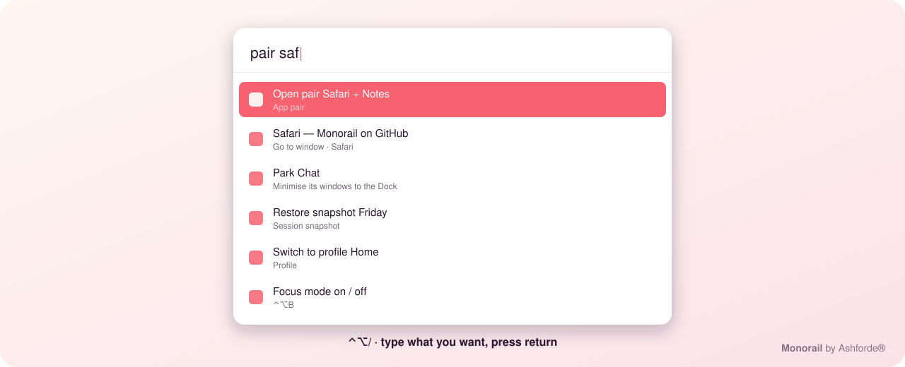</p>

**Focus mode** (<kbd>⌃⌥B</kbd>) fades everything but the slide you're in. **Snap layouts**: drag a window to the top of the screen and drop it on a zone, or press <kbd>⌃⌥E</kbd> for the radial menu.

<p align="center">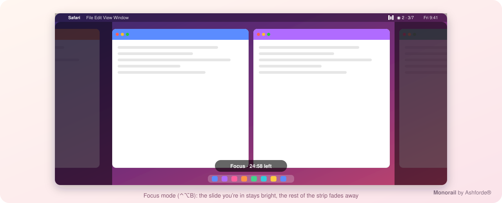</p>
<p align="center">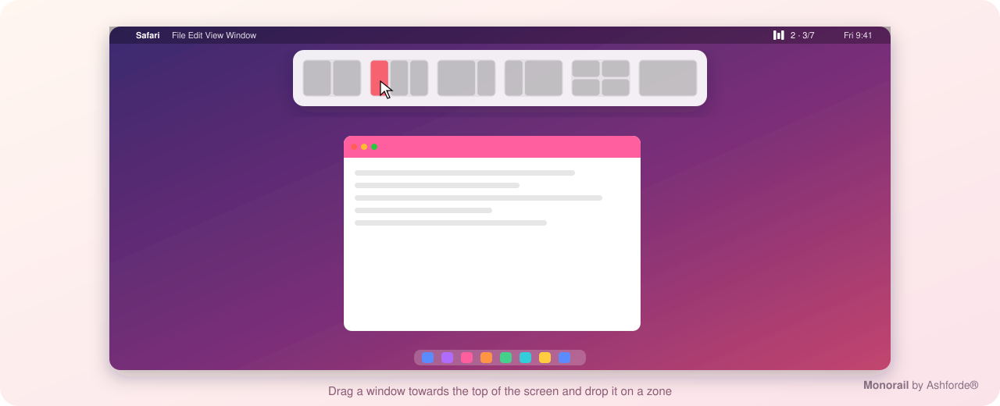</p>

**Say it, or start it**: type a sentence in the palette (“Slack and Mail side by side on 3”, “Safari two thirds”) or what you're about to do (“write the Q3 report”), and Monorail does it. It also tells you when an AI coding agent is waiting for your approval, and suggests rules from the fixes you keep making.

<p align="center">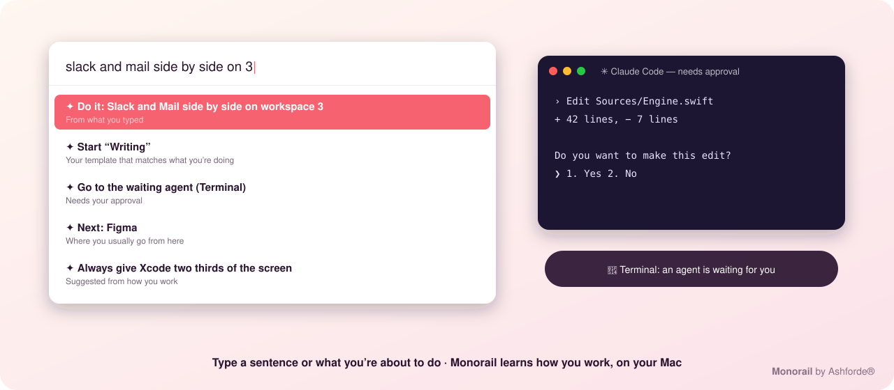</p>

**27 themes**: sixteen classics, five seasonal themes plus **Seasons**, which changes with the time of year, and five one-of-a-kind looks. **Insights** gives you a private look at how you work, with a flow score and a daily focus goal.

<p align="center">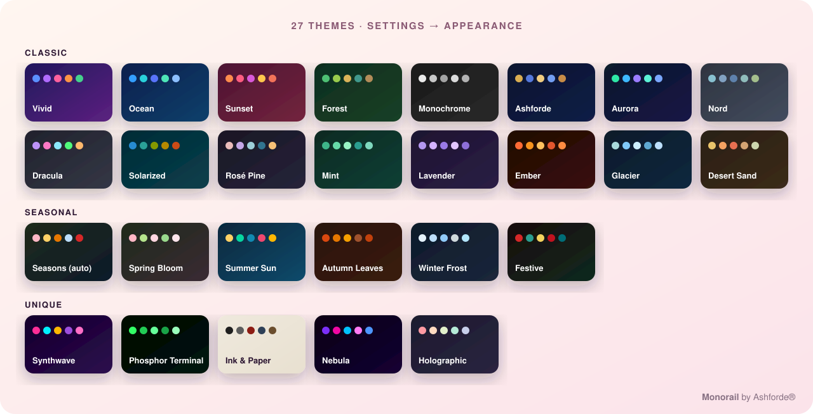</p>
<p align="center"></p>

<p align="center">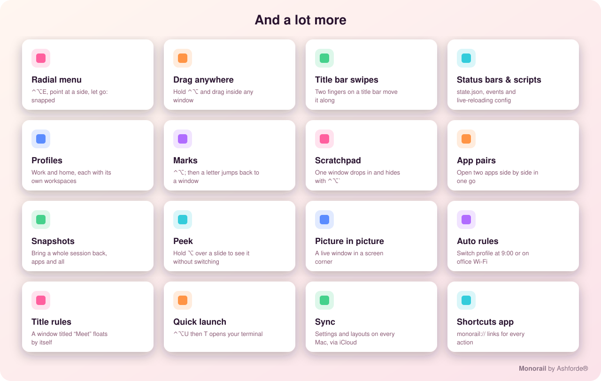</p>

## Highlights

<table>
<tr>
<td width="50%" valign="top">

### 🚝 One endless strip
Every display, Space and workspace gets its own strip. New windows open next
to the one you're using, nothing ever shrinks to make room, and windows off
screen wait out of sight. Tall slides scroll up and down too.

</td>
<td width="50%" valign="top">

### 🧩 Smart slides
Windows of the same app share a slide: two Safari windows side by side,
terminals four to a slide. Lone windows pair up when you ask. Your own
pairings stick until you **Reset to smart pairs**.

</td>
</tr>
<tr>
<td valign="top">

### 🎚️ The slider
A glass mini-map of the strip glides in as you move. Hover a slide for a
**live preview** of its windows, drag to slide everything along, click to jump.
It's in the menu bar too.

</td>
<td valign="top">

### 🗺️ Overview
<kbd>⌃⌥O</kbd> shows every slide of every workspace on one colourful canvas.
Click to jump, drag windows between slides, rename, close or minimise them
right there.

</td>
</tr>
<tr>
<td valign="top">

### ⌨️ No chords needed
Tap the right <kbd>⌥</kbd> for **slide mode**, then just press <kbd>←</kbd> <kbd>→</kbd>.
Or hold <kbd>⌥</kbd> and turn the mouse wheel, swipe on the trackpad, or scroll
over the menu bar. Full shortcuts are there when you want them.

</td>
<td valign="top">

### 📐 Layouts that stay put
Grid, side by side, up and down, main + side, main + bottom or tabs, up to six
windows a slide. Resize one and its neighbours follow; apps that move
themselves get snapped back.

</td>
</tr>
<tr>
<td valign="top">

### 🗂️ Workspaces
Up to nine per display, each with its own name and colour. <kbd>⌃⌥1</kbd>–<kbd>⌃⌥9</kbd>
switches; add <kbd>⇧</kbd> to take the window with you.

</td>
<td valign="top">

### 🔒 Native, private, safe
Swift, AppKit and SwiftUI. No account, and only anonymous usage counts you can turn off. It needs one permission
(Accessibility); the others are only for features you turn on. Pause or quit and every window comes back on
screen; undo any change with <kbd>⌃⌥Z</kbd>.

</td>
</tr>
<tr>
<td valign="top">

### 🧲 Snap, swap and pair
Drag a window to the top of the screen and pick a layout to drop it into.
Drag it over its slide-mate and they swap sides as you go. Save a slide as an
**app pair** and open both apps together any time.

</td>
<td valign="top">

### 🎛️ Profiles, marks and a scratchpad
Separate **profiles** for work and home, **marks** to jump to a window with one
letter, a **scratchpad** window that drops in and hides with <kbd>⌃⌥`</kbd>, and
**park** a whole workspace in the Dock until you need it.

</td>
</tr>
<tr>
<td valign="top">

### 🧠 Understands you
Type “Slack and Mail side by side on 3” or “write the Q3 report” and it's
done. Monorail learns where you go next and which widths you like, and offers
rules. Everything stays on your Mac.

</td>
<td valign="top">

### 🤖 Made for AI agents
Run Claude Code, Codex or Aider in terminals and hear a chime the moment one
is waiting for approval. Assistants can drive Monorail over **MCP**, and they
ask before closing anything.

</td>
</tr>
<tr>
<td valign="top">

### 🛡️ Private when it matters
Start sharing your screen and private apps step aside. They're blurred in the
overview, you can mark any window private, and **deep work** hides
distractions until you're done.

</td>
<td valign="top">

### 🎤 Built for presenting
Share one slide instead of your screen, zoom in during demos, draw on the
screen, show keystrokes, keep presenter notes only you can see, and add a
floating camera tile.

</td>
</tr>
</table>

<p align="center">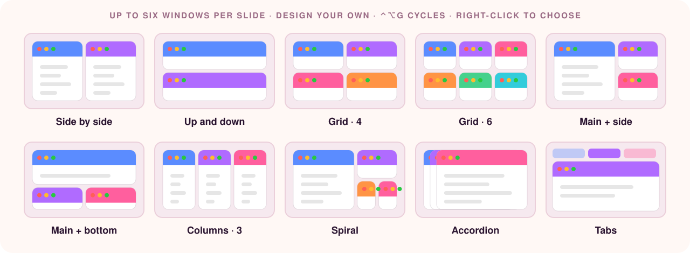</p>

### How it compares

| | Monorail | Grid tilers | Snapping tools |
| --- | :---: | :---: | :---: |
| New windows keep everyone's size | ✅ | ❌ squeezes the rest | ✅ |
| Arranges windows for you | ✅ | ✅ | ❌ manual |
| Unlimited windows per screen | ✅ on a strip | ❌ ever-smaller tiles | ❌ they overlap |
| Mouse-first controls (wheel, slider, menu bar) | ✅ | ❌ | partly |
| Groups windows by app | ✅ | ❌ | ❌ |
| Live overview you can rearrange | ✅ | ❌ | ❌ |
| Understands plain sentences | ✅ on device | ❌ | ❌ |
| Knows when an AI agent needs you | ✅ | ❌ | ❌ |
| Keeps private windows out of screen shares | ✅ | ❌ | ❌ |
| Remembers each display set, plug and unplug | ✅ | partly | ❌ |
| Free, source on GitHub | ✅ FSL | varies | mostly paid |

## Install

### Download

1. Download **Monorail-x.y.z.dmg** from the [latest release](https://github.com/ashfordeOU/monorail/releases/latest).
2. Open it. The installer window shows Monorail next to your Applications folder: **drag Monorail onto Applications**.
3. Open Monorail from Applications and allow **Accessibility** access when asked. The welcome tour walks you through it.

<p align="center">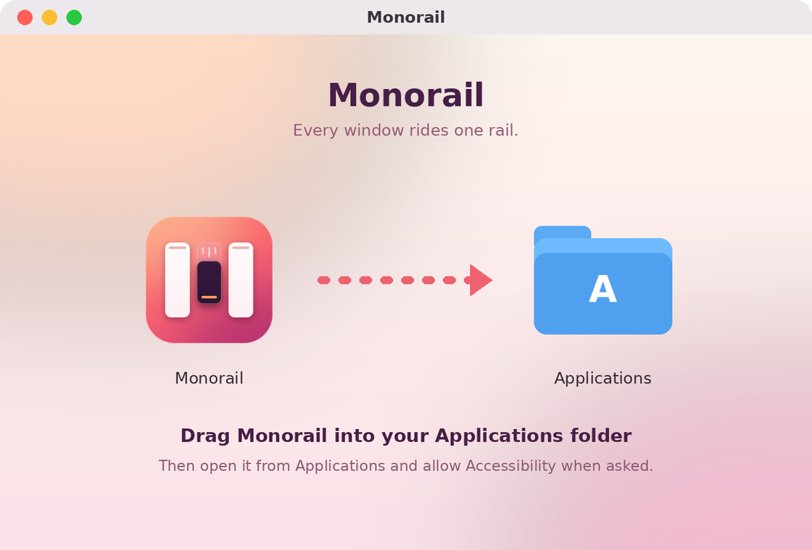</p>

> [!NOTE]
> Release builds are not yet notarized by Apple (the release pipeline notarizes
> automatically once an Apple Developer ID is added). The first time you open Monorail,
> macOS may say it can't verify the developer. Open **System Settings → Privacy & Security**
> and click **Open Anyway**. The Terminal installer below avoids this step.

### Homebrew

```bash
brew tap ashfordeOU/monorail https://github.com/ashfordeOU/monorail
brew install --cask monorail
```

### Terminal

```bash
curl -fsSL https://raw.githubusercontent.com/ashfordeOU/monorail/main/scripts/install.sh | bash
```

### More ways

- **Nix:** `nix profile install github:ashfordeOU/monorail` (or add the flake to nix-darwin).
- **MacPorts:** a Portfile is ready in [`packaging/macports`](packaging/macports) (until it is accepted upstream, use it as a local port).
- **For IT teams:** every release has a `.pkg` for Jamf, Kandji, Mosyle, Intune and Munki, plus an
  [Installomator label](packaging/installomator) and [AutoPkg recipes](packaging/autopkg).
- **Mac App Store:** a lighter, sandboxed edition is coming ([what's different](docs/APP-STORE.md)).

This downloads the latest release, installs it in `/Applications` and opens it.

### Updates

Monorail updates itself. It checks GitHub once a day, puts a dot on its menu
bar icon and an **Update to …** item at the top of its menu when a new version
is out, and offers **Install and
Relaunch** (or shows **Update** in the menu bar slider): it downloads the
release from GitHub, checks it against the published SHA-256 checksum and
Monorail's code signature, swaps it in and reopens, with your windows where
they were. Turn on **Install updates automatically** in **Settings → General**
to skip the question, or use **Check for Updates…** in the menu any time.

### Requirements

- macOS 13 Ventura or later
- Apple silicon or Intel (universal binary)
- A trackpad, only if you want swipe gestures

### Works with Keeper

Monorail and [Keeper](https://github.com/ashfordeOU/keeper) by Ashforde are made to run together. Monorail
tiles Keeper's main window like any other and leaves everything Keeper places itself where Keeper puts it:
the Island at the notch, desktop widgets, Quick Search, Quick Terminal, Capture and its HUDs.

## Getting started

When Monorail first opens, a short welcome tour walks you through granting
Accessibility access and the easiest ways to get around.

### Slide mode

Tap the **right ⌥ Option** key on its own. A small cheat sheet appears at
the bottom of the screen, and until you press <kbd>Esc</kbd> (or pause for a
few seconds) plain keys drive Monorail:

| Key | What it does |
| --- | --- |
| <kbd>←</kbd> <kbd>→</kbd> | Slide to the previous / next window. |
| <kbd>⇧←</kbd> <kbd>⇧→</kbd> | Move the window along the strip. |
| <kbd>↑</kbd> <kbd>↓</kbd> | Move between windows stacked in a column (add <kbd>⇧</kbd> to reorder). |
| <kbd>R</kbd> | Step through preset widths (¼ ⅓ ½ ⅔ ¾). |
| <kbd>F</kbd> | Fill the screen. Press again to go back. |
| <kbd>C</kbd> | Centre the window. |
| <kbd>1</kbd>–<kbd>9</kbd> | Jump to a column. |
| <kbd>-</kbd> <kbd>=</kbd> | Narrower / wider. |
| <kbd>[</kbd> <kbd>]</kbd> | Stack into the left column / unstack. |
| <kbd>T</kbd> <kbd>W</kbd> <kbd>P</kbd> <kbd>D</kbd> | Float, tabs, pin, send to the next display. |
| <kbd>Esc</kbd> <kbd>Return</kbd> | Done. Any other key also ends slide mode and goes to your app. |

The trigger key can be right ⌥, ⌘, ⌃ or ⇧ in **Settings → Motion & Input**.
Holding the key as a normal modifier never turns slide mode on, only a tap does.

### Slides and the overview

With **Group windows into slides by app** on (the default), Monorail fills
the strip with full-screen slides:

- Windows of the same app share a slide: two side by side, or four in a 2×2 grid for terminals (Terminal, iTerm, Ghostty, Warp, kitty, Alacritty, WezTerm).
- A new window of an app that's not on the strip yet gets a slide of its own. Pressing <kbd>⌃⌥A</kbd> pairs lone windows of different apps (or turn on pairing as they open in **Settings → Layout**).
- Open a second window of an app that is sharing a slide, and the two windows move to a slide of their own.
- Windows that come back return to exactly where they were: unhidden, unminimised, reopened from the Dock after closing, or after quitting and relaunching the app.

**Resize by hand, and the slide follows.** Drag the edge of a window in a
slide and the windows next to it resize live to fill the space. When you let
go, a small popup offers **Keep**, **Own slide** (move this window to a slide
of its own), **Move others out** (keep it here, move the rest to a new slide)
or **Undo**. Ignore it and it fades away.

**Undo anything.** <kbd>⌃⌥Z</kbd> (or <kbd>Z</kbd> in slide mode, or **Undo
Layout Change** in the menu) steps back through your recent layout changes:
moves, resizes, pairings, layouts and resets.

**Layouts stay put.** Some apps (Firefox, for one) occasionally resize or
move their own windows. Monorail notices that it wasn't you — no mouse button
was down — and snaps the window straight back. Dragging and resizing by hand
still work as before. Turn this off in **Settings → Layout** if you prefer.

**Your own pairings stick.** Pair windows yourself (say one Safari and one
Finder window) by dragging in the overview or with <kbd>⌃⌥[</kbd> / <kbd>⌃⌥]</kbd>,
and Monorail keeps that slide as you made it: new windows won't break it up
or squeeze into it, and it's saved across Monorail restarts. To go back,
**Reset to smart pairs** (<kbd>⌃⌥A</kbd>, the ✨ button in the menu bar slider,
or the overview) regroups every workspace by app in one step.

Change the tiles per slide (up to six — more gets too crowded) and the layout for any app under **Settings → Apps**.

### Slide layouts

<kbd>⌃⌥G</kbd> (or <kbd>G</kbd> in slide mode) cycles the focused slide through:

| Layout | Arrangement |
| --- | --- |
| Grid | Grows with the count: 2 side by side, 2×2, 3×2. A short last row stretches to fill. |
| Columns | All side by side, full height. |
| Main + side | One large window, the rest stacked beside it. |
| Main + bottom | One large window on top, the rest in a row below. |
| Rows | All stacked, full width. |

<kbd>⌃⌥.</kbd> and <kbd>⌃⌥,</kbd> make the main window larger or smaller;
<kbd>⌃⌥M</kbd> makes the focused window the main one. <kbd>⌃⌥W</kbd> turns a
slide into tabs. Arrow keys move between tiles by where they are on screen, then
on to the next slide. Choose the layout for new slides in **Settings → Layout**.

**Design your own** in **Settings → Layout → Custom slide layouts**: choose how
many columns and how many rows each has ("one big beside two stacked", "two,
big, two"), up to six windows. Pick one from a slide's right-click menu ▸
**Slide Layout**.

**Windows that can't shrink.** Some apps (the App Store, a few settings
windows) have a minimum size bigger than half the screen. Monorail notices
when a window refuses its tile, gives it a slide of its own, and remembers
the app so its windows open on their own slide from then on.

**Swap and resize inside a slide.** Drag a window by its title bar over
another window in the same slide and the two trade places as you drag, the
other one sliding across to the side you came from; in a main layout the
window takes over the main spot. Drag the edge between two windows and the
neighbour grows or shrinks to match.

### Radial menu

Press <kbd>⌃⌥E</kbd> and a ring appears at the pointer. Move towards a side or
a corner and an outline shows where the focused window will go; let go of
<kbd>⌃⌥</kbd> (or click) and it snaps there. The middle fills the screen,
<kbd>Esc</kbd> cancels. A quick tap leaves the ring open until you click.

### Snap layouts picker

Drag any window towards the top of the screen and a strip of layouts drops
down: halves, thirds, two thirds, quarters and full screen. Let go over a zone
and the window snaps there, floating. Turn it off in **Settings → Layout**.
If macOS also tiles windows dragged to the very top edge, you can switch that
off in System Settings → Desktop & Dock → Windows.

### Saved layouts

Arrange things the way you like for a task, then **Saved Layouts → Save
Current Layout…** in the menu and give it a name ("Coding", "Writing"). Later,
choose it from **Saved Layouts** and every open window that matches goes back
to its slide, in every workspace: same app and title first, then any window of
the same app. Windows that aren't in the layout stay, after it.

### After a restart

Monorail remembers your slides by app and window title. When your Mac
restarts and apps reopen their windows, each one goes back to the slide and
workspace it was in.

### Snapping floating windows

Need one window somewhere specific for a moment? <kbd>⌃⌥⌘</kbd> plus a key snaps
the focused window (floating it first if it was tiled):

| Keys | Snap to |
| --- | --- |
| <kbd>⌃⌥⌘←</kbd> <kbd>⌃⌥⌘→</kbd> <kbd>⌃⌥⌘↑</kbd> <kbd>⌃⌥⌘↓</kbd> | Left, right, top or bottom half |
| <kbd>⌃⌥⌘D</kbd> <kbd>⌃⌥⌘F</kbd> <kbd>⌃⌥⌘G</kbd> | First, centre or last third |
| <kbd>⌃⌥⌘E</kbd> <kbd>⌃⌥⌘T</kbd> | First or last two thirds |
| <kbd>⌃⌥⌘U</kbd> <kbd>⌃⌥⌘I</kbd> <kbd>⌃⌥⌘J</kbd> <kbd>⌃⌥⌘K</kbd> | Top-left, top-right, bottom-left, bottom-right quarter |
| <kbd>⌃⌥⌘↩</kbd> / <kbd>⌃⌥⌘C</kbd> | Maximise / centre |
| <kbd>⌃⌥⌘⌫</kbd> | Restore: back where it was (back on the strip if it was tiled) |

### Right to left

Set **Strip direction** to **Right to left** in **Settings → Layout** and the
first slide sits at the right edge, new windows open to its left, and keys,
swipes, the slider bar and the overview all follow.

Press <kbd>⌃⌥O</kbd> (or <kbd>O</kbd> in slide mode, or **Overview** in the
menu bar) to see every slide of every workspace at once:

- **Click** a window to jump to it, or a workspace title to switch to it.
- **Drag a window** onto another slide to group it there, or into the gap between slides to give it a column of its own. It can go to another workspace too.
- **Drag a slide** by its ≡ handle to reorder the strip.
- **Drop a window on the bin** at the top to close it.
- **Arrow keys** move a highlight between windows, <kbd>↩</kbd> jumps to it, <kbd>⌫</kbd> closes it.
- Hold <kbd>⌥</kbd> and **pinch** on the trackpad to open the overview; pinch out to close it.
- Turn on **Show live previews** to see window contents. This needs Screen Recording permission; without it you see app icons and titles.

### Slider bar

**Click the Monorail icon** in the menu bar for the slider, every slide as a
card, and pause, overview and settings buttons. Right-click (or ⌃-click) the
icon for the full menu.

While the strip moves, a slider bar fades in at the bottom of the screen:
every slide in the workspace as a small tile with its apps' icons, and a
highlighted frame for the part that's on screen.

- **Hover** a tile for a live preview of that slide's windows, laid out as they are on screen; click one to jump straight to it.
- **Drag** the frame, or anywhere on the bar, or just **scroll** over it, and all your windows slide along.
- **Click** a tile to jump to that slide.
- **Dots** on the left switch workspaces; hover one to see its name, right-click to rename it. The grid button on the right opens the overview.
- In previews and the overview, every window has **close, minimise and full-screen** buttons, and a right-click menu to **rename** it, give it its own slide, or move it to another workspace.

You choose during the welcome tour: the slider bar plus the menu bar icon, or
the menu bar icon only. Switch any time with **Show the slider bar** in
**Settings → Appearance**. When it's on, keep it on screen all the time (windows
leave room for it) or only while sliding, at the bottom or the top. When it's
off, windows fill the screen right down to the Dock.

### Workspaces

Give an app a home workspace in **Settings → Apps** and its new windows
always open there (Slack in "Chat", Mail in "Personal").

Name your workspaces ("Work", "Personal", "Design") in **Settings → General**,
or right in the overview: click the pencil (or right-click a dot on the slider
bar) and type the new name in place. Each workspace
has its own colour in the overview and the slider bar.

Each display has four workspaces by default (up to nine in **Settings → General**).
<kbd>⌃⌥1</kbd>–<kbd>⌃⌥9</kbd> switches workspace, and <kbd>⌃⌥⇧1</kbd>–<kbd>⌃⌥⇧9</kbd>
moves the focused window to one. The menu bar shows where you are (`2 · 3/5` is
workspace 2, slide 3 of 5). Switching to a window with ⌘Tab takes you to its workspace.

### Profiles

A profile is a whole set of workspaces, for keeping work and home (or two
clients) apart. Add profiles in **Settings → General → Profiles**, then switch
with <kbd>⌃⌥0</kbd> or **Profile** in the menu bar. Windows of the other
profiles wait out of sight, each workspace remembering its slides. Turn on
**Only show workspaces in use** and the dots, menus and overview list just the
workspaces you are using, plus one empty one.

### Marks and the scratchpad

- **Marks**: press <kbd>⌃⌥⇧;</kbd> then a letter to mark the focused window; later <kbd>⌃⌥;</kbd> and the same letter jumps straight back to it, wherever it is. Marked windows show their letter in the overview.
- **Scratchpad**: <kbd>⌃⌥⇧`</kbd> makes the focused window the scratchpad (a notes app or a terminal, say). <kbd>⌃⌥`</kbd> drops it in over everything, centred; press again to tuck it away.

### App pairs

Right-click a window in a slide (in the slider's preview or the overview) and
choose **Save Slide as App Pair…**. Later, **App Pairs** in the menu bar opens
those apps, launching any that aren't running, and puts them together in one
slide with the same layout.

### Parking a workspace

**Workspaces → Park Workspace** in the menu bar (or right-click a workspace in
the overview) minimises all its windows to the Dock. **Bring Back** puts every
one of them back on exactly the same slides.

### Attention markers

When an app shows a badge on its Dock icon (unread mail, a new message), its
windows get a small red dot on the slider bar, in the overview and in window
search, so you can see which slide wants you.

### Power moves

- **Drag anywhere**: hold <kbd>⌃⌥</kbd> and drag anywhere inside a window to move it, or right-drag to resize it. A tiled window lands where you drop it.
- **Title bar swipes**: turn them on in **Settings → Motion & Input**, then swipe with two fingers on a title bar: left or right moves the window's slide, up makes it full width, down minimises it.
- **Spiral and accordion layouts**: spiral gives each window the main share of what's left, turning inwards; accordion overlaps windows like cards so every edge shows.
- **Even out** (<kbd>⌃⌥⇧=</kbd>): every slide back to the default width and split.
- **Back and forth** (<kbd>⌃⌥⇧⌫</kbd>): back to the workspace you were just on.
- **Empty workspace** (<kbd>⌃⌥⇧N</kbd>): take the window to the first empty workspace and go with it.
- **Attention** (<kbd>⌃⌥⇧A</kbd>): go to the window whose app has a badge in the Dock.
- **Show desktop** (<kbd>⌃⌥⇧D</kbd>): every window slides aside; click one or press again to bring them back.
- **Screenshot the slide** (<kbd>⌃⌥⇧C</kbd>): the slide you're in, saved to the Desktop and copied.
- **App overview** (<kbd>⌃⌥⇧O</kbd>): the overview with just the focused app's windows.
- **Size while resizing**: a label shows the window's size as you drag its edge.
- **A picture per workspace**: give each workspace its own desktop picture in **Settings → General**.
- **Gradient border**: the focus border can fade into a second colour.
- **Less motion**: animations step aside when macOS's Reduce Motion or Low Power Mode is on.

### Get there faster

- **Window hints** (<kbd>⌃⌥V</kbd>): a big letter appears on every window on screen; type one to go there.
- **Resize mode** (<kbd>⌃⌥⇧E</kbd>): <kbd>←</kbd> <kbd>→</kbd> change the width, <kbd>↑</kbd> <kbd>↓</kbd> the main window's share, <kbd>1</kbd>–<kbd>9</kbd> set the width in tenths of the screen, <kbd>0</kbd> fills it, <kbd>Esc</kbd> when done.
- **Zoom out on the strip** (<kbd>⌥</kbd> + pinch, or <kbd>⌃⌥⇧Z</kbd>): the whole strip shrinks under your fingers until it all fits; click a slide to go there.
- **Workspaces up and down**: turn on vertical swipes in **Settings → Motion & Input** and swipe up or down (with the fingers you swipe sideways with) to slide to the next or previous workspace.
- **Recent slides**: the menu bar and the command palette list the slides you were just on.

### Made for how you work

- **Remembered widths**: give an app's window a width once and its new windows open at that width.
- **A centred lone window**: when a workspace has one window, it can sit centred at 50–80% of the screen instead of stretching edge to edge.
- **The focused window grows**: in a slide of two, the one you're in can take 55–70%.
- **Projects**: list your projects in **Settings → Layout**; windows whose titles name one (your editor, terminal and browser on "monorail") gather in that project's workspace.
- **Tabs**: tabbed slides show each app's icon; drag a tab out onto another slide to move the window there.
- **Workspace templates** (**Settings → Apps**): "Coding" opens Xcode with your project, Safari at your links and Terminal in your folder, side by side in a fresh workspace. Start one from the menu bar, the palette or `monorail://template/Coding`.
- **Meetings** (**Settings → Automation**): a minute before a calendar event with a Zoom, Meet, Teams, Webex or FaceTime link, Monorail opens the call and can switch profile.
- **Presentation mode** (<kbd>⌃⌥⇧Y</kbd>): the slider, focus border, dimming and notices step out of sight while you present or share your screen.
- **Record the slide** (<kbd>⌃⌥⇧V</kbd>, again to stop): a movie of just the slide you're in, saved to the Desktop. The menu bar shows ● REC meanwhile.
- **Time**: Insights shows where your time went, per workspace and app, today and this week.
- **Share layouts**: **Saved Layouts → Share Layout…** makes a `.monorail` file; double-click one on any Mac to add and apply it. Templates and app pairs share the same way.
- **In your language**: menus, Settings tabs and the welcome tour in English, Deutsch, Français, Español and 日本語 (**Settings → General → Language**).
- **Practice windows**: the welcome tour can open three practice windows, so you learn the moves without touching your work.

### New in 1.7

- **Nested slides:** drag a window onto another's edge to dock it beside, or onto its middle to make a tab group, any apps, as deep as you like. Drag the gap between two windows to resize both.
- **Saved views:** **⌃⌥⌘⇧1…9** saves where you are, **⌃⌥⌘1…9** brings you back; **⌃⌥⌘[ ]** goes back and forward.
- **Zone editor:** draw any slide layout in Settings → Apps → Design Zones….
- **Import** your AeroSpace, yabai/skhd or Rectangle settings from Settings → Basics.
- **Tags:** keep a window on chosen workspaces, or show another workspace alongside this one.
- **`monorail subscribe`:** a live stream of events for menu bars and scripts.
- **Basics** page in Settings, and app-colour tiles in the overview without Screen Recording.

#### How docking works

Drag any window by its title bar onto another window:

- **Near an edge** (the outer 40% on each side, so only the centre fifth makes a tab group) it docks on that side. The window you dropped onto
  gives up half its space, and nothing else moves. A highlight shows where it will land before you let go.
- **In the middle** the two become a **tab group** with a tab bar, even if they're different apps.
  Click a tab to switch, or drag a tab out to tear it off.
- **Onto a window that's already docked**, that half splits again, as deep as you like.
- **Drag the gap** between two windows to resize both at once.
- Floating windows can be docked the same way.

To **undock**: <kbd>⌃⌥⇧]</kbd> gives the focused window a slide of its own (or choose **Tear off**
in the palette). <kbd>⌃⌥T</kbd> floats it, and <kbd>⌃⌥G</kbd> turns the whole slide back into a
standard layout. <kbd>⌃⌥Z</kbd> undoes the last dock. From the keyboard, **Dock onto the window on
the left / right / above / below** can be given shortcuts in Settings → Shortcuts. Turn docking off
in Settings → Layout if you prefer dragging to swap windows.

### New in 1.6

- **Settings has a sidebar**, grouped into Essentials, Make it yours, Power and Monorail, with search at the top.
- **Snapshots save browser tabs and Finder windows** if you turn it on (Settings → Smart), and reopen them when you restore.
- **Share links:** **Layouts → Copy Share Link** makes a link with a web preview and an **Open in Monorail** button. Titles and tabs are never included.
- **Assistant (optional):** with your own Anthropic API key, sentences Monorail doesn't understand go to Claude, which turns them into Monorail commands. You confirm before anything runs.
- **Float suggestions:** float an app's windows by hand three times and Monorail offers to always float it.
- **Anonymous usage counts** help us see which Macs and features to focus on. See [Privacy](#privacy) for exactly what's sent and how to turn it off.
- **New licence:** the [Functional Source License](docs/LICENSING.md). Free to use and change; not for resale.

### New in 1.5

- **Ask Monorail:** type “how do I…?” in the palette. **Search** at the top of Settings finds any option.
- **Check Energy** in About measures Monorail's own CPU, wake-ups and power in 30 seconds.
- **A session timeline** in Insights, a **meeting layout** that puts your notes beside calls, and **Sidecar** iPads that fit every slide.
- **A script gallery** with one-click installs, **Homebrew**, and timely **tips**.
- **Lighter:** heavy features load only when first used. The overview opens with last time's previews, and screenshots no longer count as screen sharing.

### New in 1.4

- **Floating windows never stay out of view.** Get Info panels, Settings windows and inspectors open where the app puts them. If that would be off screen, they open over the app's window instead, staggered when several open at once. They come back into view if anything leaves them there later.
- **Usage in Settings → About:** how long Monorail has run, what it has cost in CPU and memory, and what you use most. It's all kept on your Mac.
- **A What's New tour** with **Try it** buttons, plus **Report a Problem…**, which fills in a GitHub issue for you.
- **Nine languages:** English, German, French, Spanish, Japanese, Chinese (Simplified), Portuguese, Korean and Italian for the menus and Settings.
- **Lighter in use.** Overlays only redraw when something changes, and overview previews are smaller.
- For contributors and testers: [docs/TESTING.md](docs/TESTING.md) (a real-Mac checklist) and [docs/NOTARISATION.md](docs/NOTARISATION.md).

### New in 1.3: Stay Awake ☕

Monorail can keep your Mac awake, like Amphetamine, with no extra app to install. Choose **Stay Awake** in the menu bar, use the command palette, give it a shortcut, run `monorail awake 60`, or open `monorail://awake`.

- **Sessions:** until you end it, for 15 minutes up to 12 hours, until a clock time, while an app is open, or while something downloads. The menu bar shows ☕ and the time left.
- **Display:** keep it on, or let it sleep while the Mac stays awake. You can allow the screen saver, and still have the screen lock after the idle time you choose.
- **Stays awake by itself** when a trigger applies:
  - an app is open or in front
  - an external display or drive is connected
  - you're on a particular Wi-Fi network or charging
  - a weekly schedule (overnight works too)
  - the Mac is busy, or something is downloading
- **While awake:**
  - It can nudge the pointer now and then, so chat apps don't mark you away.
  - It can keep external drives from spinning down.
  - **Closed-lid mode** keeps a MacBook running with its lid shut, even without an external display. macOS asks for your password each time.
- **Battery safety:** Stay Awake ends when the battery drops to a level you choose (10% by default) and the Mac isn't charging.
- **Automation:** `POST /awake` in the local API, the `stay_awake` MCP tool, webhooks when it starts and stops, and notices and sounds if you want them.
- It uses the same power assertions as macOS's own `caffeinate`, so it costs almost nothing. With no session and no triggers it does no work at all.

Also in 1.3, Monorail is lighter on energy: background checks rest while the screen sleeps or is locked, and they run at half speed in Low Power Mode or on battery. Settings → About shows how much CPU time Monorail has used.


<p align="center">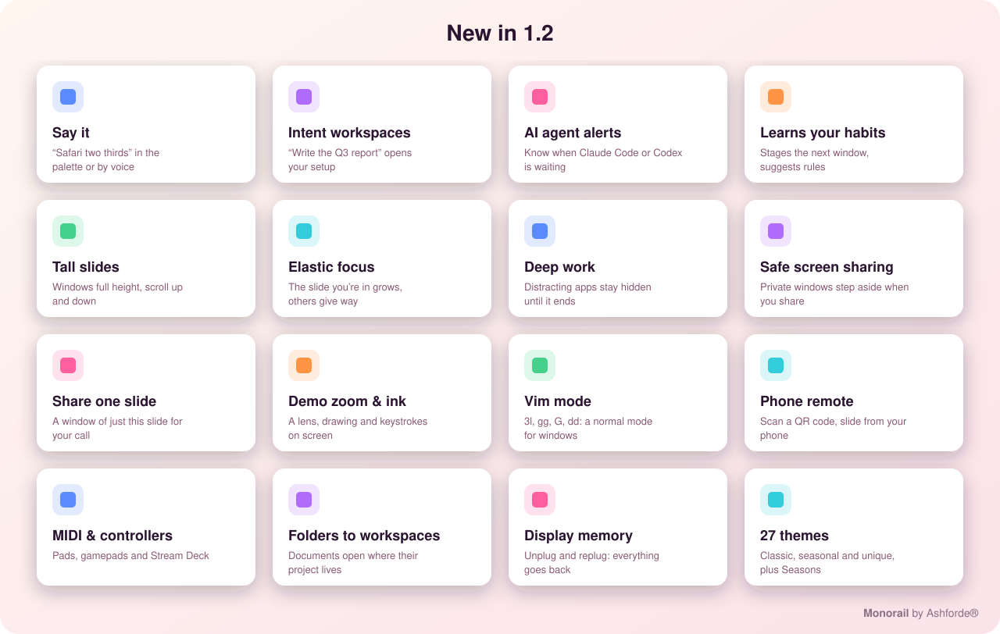</p>

1.2 brings a hundred new capabilities. Everything that learns from you does it on your Mac, and nothing is sent anywhere. Every new action is in the command palette (<kbd>⌃⌥/</kbd>), and you can give any of them a key in **Settings → Shortcuts**.

**Smart** (Settings → Smart)
- **Say it.** Type a sentence in the palette, or use **Voice command**:
  - “Slack and Mail side by side on 3”
  - “Safari two thirds”
  - “move Mail to workspace two”
  - “focus mode on”
- **Intent workspaces.** **Start working on…** takes what you're about to do (“write the Q3 report”) and opens the template, saved layout, app pair or workspace that fits.
- **AI agent alerts.** Monorail watches terminals running Claude Code, Codex, Aider, Gemini and others. When one asks for approval, you hear a chime and the palette offers to take you there. You can also have the agent's slide brought into view.
- **Learns your habits:**
  - It stages the window you usually go to next beside you (optional).
  - **Go to the window you usually go to next** jumps straight there.
  - It suggests a rule when you keep giving an app the same width.
  - It nudges you towards focus mode when you're switching a lot.
- **Content-aware widths** (optional). New slides get a width that suits the app: about 100 columns for code and terminals, a page for documents, a full web page for browsers.
- **Sort windows into project workspaces.** Monorail finds projects in window titles (“Engine.swift — monorail”), gives each project its own workspace and names it.
- **Folders to workspaces.** Documents from `~/Clients/Acme` open in the Acme workspace.

**The strip**
- **Tall slides.** Each window gets nearly the full height, and you scroll the slide up and down with the next window peeking in below.
- **Elastic focus.** The slide you're in grows and the others give way.
- **Whole slides only** (on by default). Slides that would be cut off at the screen edge wait out of sight instead.
- **Bookmarked views.** Save a spot on the strip, then hop between your bookmarks.
- **Try a layout.** Fork the workspace, experiment, then **Keep** or **Discard**.
- **Window groups.** Windows you add to a group move between workspaces together.
- **Layout timeline.** Scrub back through every change you made.
- **Linked slides.** Two slides on different displays scroll into view together.
- **Reading mode** gives you one calm, centred column, and **Centre the main slide** suits ultrawide displays.
- **Display memory.** Unplug a display and its slides wait for it. Plug it back in and they return as they were. **Display profiles** keep a layout for each set of displays: desk, café or projector.

**Focus and privacy** (Settings → Smart, Settings → Devices & Sharing)
- **Deep work.** Distracting apps are hidden and stay hidden until it ends. Calendar events called *Focus* or *Deep work* can start it for you.
- **Safe screen sharing.** When you share your screen in Zoom, Teams, Meet, Webex, Slack or FaceTime, private apps and windows you've marked private step aside. They're blurred in the overview too.
- **Contexts.** A workspace can run a Shortcut when you arrive, for example to turn on a Focus, switch audio or set your Slack status. It can also have a **time budget** that nudges you once a day when it's used up.
- **Flow score and daily focus goal** in Insights.
- **Per-workspace clipboard.** What you copied in a workspace stays with it. It skips anything a password manager marks as secret.
- **Guest mode.** Monorail steps aside while someone else uses your Mac, and your layout comes back afterwards.

**Presenting**
- **Share one slide.** You get a window of just this slide to pick in your call, rather than your whole screen.
- **Mirror a window** on another display, a **demo zoom** lens that follows the pointer, **draw on the screen**, and **show keystrokes and clicks**.
- **Presenter notes.** Only you can see them, even while sharing the whole screen.
- **A round camera tile** that floats over everything.
- **Sync your layout with a nearby Mac**, for pair programming.
- **Continue on my other Mac** (with iCloud sync).

**Devices**
- **Choose the Monorail key.** Caps Lock, or right ⌘, ⌥ or ⌃.
- **Vim mode.** `h j k l` with counts (`3l`), `gg` and `G`, `dd`, `w` and `b`, `u` and `/`. Press `i` or Esc to leave.
- **Mouse gestures.** <kbd>⌃⌥⇧</kbd> + drag.
- **MIDI controllers**, with learn mode, and **game controllers**. **Stream Deck** buttons work through `monorail://` links (see [extensions/streamdeck](extensions/streamdeck)).
- **Phone remote.** Scan a QR code to slide, switch workspace and open the overview from your phone. The link holds a secret.
- **Head focus** (experimental). Turn towards a display to focus it.
- **Find a window by what's in it.** Monorail reads the window pictures on your Mac, so “invoice 4471” finds the right window.

**Platform**
- **Scripts:**
  - `monorail.addCommand(title, fn)` puts your own commands in the palette.
  - `monorail.setWidths([…])` lets you write layouts as code.
  - `monorail.say("…")` carries out a sentence.
- **Local API, MCP and CLI:**
  - New API endpoints: `say`, `agents`, `predict` and `context`.
  - New MCP tools: `say` and `get_waiting_agents`.
  - Assistants have to ask before closing windows.
- **Extensions:**
  - A [browser companion](extensions/browser).
  - A [VS Code extension](extensions/vscode) that names workspaces after your project.
  - A [SketchyBar plug-in](extensions/sketchybar).
- **Organisations:**
  - Settings can be managed with a configuration profile (MDM).
  - Hold <kbd>⌥</kbd> while opening Monorail for **safe mode**.
  - Optional crash reports stay on your Mac.
  - Known app quirks update themselves.
- **Delight:**
  - 27 themes, including **Seasons**.
  - Sound packs.
  - A wallpaper that drifts gently as the strip scrolls.
  - Slides and workspaces around the MacBook notch.
  - Animation that follows ProMotion displays up to 120 Hz.
  - Live previews in the overview.

### New in 1.1

A hundred new capabilities. Every new action is listed in Settings → Shortcuts → *Slides (1.1)* and the groups after it, and in the command palette.

- **A narrow menu bar:** your position is drawn into the icon itself, with a pip per slide and a dot per workspace. There's no text. The ‹ › arrows are one small item, off by default.
- **Slides on the move:**
  - Send the whole slide to the start or end of the strip, or to another workspace.
  - Unpair or merge slides.
  - Cycle tiles, and reset a slide's split.
- **Exact widths and layouts:** a key for each width (¼ to ¾) and for each slide layout.
- **Each workspace its own way:** a colour, layout, gap and focus mode for each workspace, or close it to new windows (Settings → Automation).
- **Opening things beside you:** open an app or the copied link right next to the window you're in.
- **Smarter rules:**
  - Per-app full width, tabs, pins, every workspace and scratchpad.
  - Partner apps that pair themselves.
  - Small and Settings windows float.
  - Tiling pauses for games and video.
- **The mouse:**
  - Back and forward buttons step slides.
  - ⌥ + middle-click zooms a window.
  - ⌃⌥ + scroll resizes a slide.
  - ⇧ + scroll switches workspace.
  - Hot corners.
- **Find your place:**
  - Find the pointer.
  - Flash the focused window.
  - A glowing border, or one in the app icon's colour.
  - Window notes.
- **Focus:** a pomodoro timer in the menu bar, break reminders and a daily focus goal.
- **Automation:**
  - Webhooks.
  - Remote commands (`org.ashforde.monorail.perform`).
  - New API endpoints, MCP tools, URLs and `monorail` commands.
  - A log viewer.

### New in 1.0

- **Caps Lock as the Monorail key**: turn it on in **Settings → General** and hold Caps Lock instead of <kbd>⌃⌥</kbd> for every shortcut (Caps Lock + <kbd>→</kbd> slides right). Tap it on its own for the command palette. macOS gets Caps Lock back when you quit Monorail.
- **Fit mode**: a workspace where every slide shares the screen, like classic tiling, so nothing scrolls. Turn it on for all workspaces, or for one from the overview (the **Scrolling / Fit on screen** button on each workspace) or **Fit Every Slide on Screen** in the menu bar.
- **Your style in one click**: the welcome tour and **Settings → General → Style** offer **Scrolling strip**, **Fit on screen** and **Minimal**.
- **Undo History**: the menu bar lists recent layout changes with their times; pick one to go back to just before it.
- **What's New** appears after each update.
- **Beta updates**: opt in under **Settings → General** to get early versions.
- **Workspace notes**: write a line under any workspace in the overview ("Q4 report: draft by Friday"); it shows as you switch there.
- **Auto names**: a workspace you haven't named takes its apps' names ("Xcode & Safari").
- **Pick several windows**: in the overview, ⌘-click (or ⇧-click) windows, then put them together in one slide, move them to a workspace, minimise or close them at once.
- **Your week**: a notification on Monday mornings with last week's switches, where your time went and the apps you paired most.

### Even more (0.9)

**Hold <kbd>⌃⌥</kbd>** for a moment and a cheat sheet of every shortcut appears; let go and it's gone.

- **Moving between places**: <kbd>⌃⌥PageDown</kbd> / <kbd>⌃⌥PageUp</kbd> next or previous workspace (add <kbd>⇧</kbd> to take the window), <kbd>⌃⌥⇧.</kbd> the next display, <kbd>⌃⌥⇧,</kbd> moves the whole workspace to the next display. **Swap displays** and **Move to the pointer's display** are in the palette.
- **Windows**: <kbd>⌃⌥\\</kbd> the next window of the same app, <kbd>⌃⌥⇧Tab</kbd> swap with the window you were just on, <kbd>⌃⌥Y</kbd> redo.
- **Slides**: <kbd>⌃⌥⇧G</kbd> rotate the windows in a slide, <kbd>⌃⌥⇧M</kbd> flip it. Name a slide or lock it (smart pairs and new windows leave it alone) from its right-click menu. Also: widen to fill the free space, sort slides by app, close or minimise a whole slide, gather an app's windows into one slide.
- **Modes**: <kbd>⌃⌥⇧B</kbd> solo (hide every other app, again to bring them back), <kbd>⌃⌥⇧0</kbd> gaps on or off (bigger and smaller gaps too), new windows open in the focused slide or next to their app's other windows.
- **Floating windows**: they go back where you last put them, **Centre** puts one in the middle, and **Size for Recording** makes one exactly 1280 × 720, 1920 × 1080 and more.
- **Rules**: give an app a home display; **Never Manage This App** from any window's right-click menu.
- **Looks**: the workspace's name shows as you switch, the overview has search and a card-size slider, the slider bar can show window titles or be compact, the menu bar can show a dot per slide or just the workspace number, quiet mode hides notices, and an optional soft click plays as you slide.
- **Accessibility**: VoiceOver announces the slide and workspace you move to.
- **Safety nets**: floating windows and dialogs come back on screen by themselves when a display is unplugged or after sleep, and **Rescue Windows** in the menu brings every window back if anything ever gets lost; a "Last session" snapshot is kept on quit and sleep; settings are backed up daily (seven kept, restore in **Settings → General**); **Copy Diagnostics** in About makes a bug report easy.
- **Battery**: animations can step aside on battery.
- **Insights** export as CSV.

### AppleScript and the command line

```applescript
tell application "Monorail"
    perform "focus-left"
    apply layout "Coding"
    open pair "Safari + Notes"
    set state to current state -- JSON
end tell
```

```bash
monorail focus-left
monorail layout Coding
monorail windows      # JSON, with the local API on
```

### AI assistants (MCP)

Turn on **Local API** in **Settings → Automation**, click **Copy MCP Server Config** and add it to
Claude Desktop (or any MCP client):

```json
"monorail": { "command": "/Applications/Monorail.app/Contents/MacOS/Monorail", "args": ["--mcp"] }
```

Then ask things like "put my editor and browser side by side" or "move Slack to workspace 3".
The API only listens on this Mac, and every request needs a token that only you can read.
Monorail asks you before an assistant closes a window.

| MCP tool | Does |
| --- | --- |
| `get_state`, `list_windows`, `list_workspaces` | Where everything is |
| `focus_window`, `move_window`, `pair_windows`, `switch_workspace` | Move around and arrange |
| `perform_action` | Any of the [226 actions](docs/ACTIONS.md) |
| `apply_layout`, `open_app_pair`, `run_template` | Bring back a setup |
| `say` | Carry out a sentence (“Safari two thirds”) or an intent (“write the Q3 report”) |
| `undo`, `redo`, `get_history` | Take changes back |
| `name_slide`, `set_slide_layout`, `note_window`, `close_window` | Edit slides and windows |
| `get_waiting_agents` | Terminals whose AI agent is waiting for approval |
| `stay_awake` | Keep the Mac awake for some minutes, or end it |
| `notify`, `get_insights` | Show a notice; today's usage and focus |

The local API has the same endpoints under `GET`/`POST http://127.0.0.1:4767/…`:
`state`, `windows`, `workspaces`, `layouts`, `pairs`, `templates`, `snapshots`, `actions`, `action`, `focus`,
`move`, `pair`, `workspace`, `layout`, `pair-name`, `template`, `snapshot`, `undo`, `redo`, `history`,
`name-slide`, `slide-layout`, `close`, `note`, `notify`, `insights`, `say`, `agents`, `predict`, `context` and `awake`.

The same API serves the extensions in this repository and your own scripts:
- [Raycast](extensions/raycast)
- [Alfred](extensions/alfred)
- [Stream Deck](extensions/streamdeck)
- [a browser companion](extensions/browser)
- [VS Code / Cursor](extensions/vscode)
- [SketchyBar](extensions/sketchybar)

```bash
curl -H "Authorization: Bearer $(cat ~/Library/Application\ Support/Monorail/api-token)" http://127.0.0.1:4767/windows
```

### Scripts

Turn on **Scripts** in **Settings → Automation** and drop `.js` files in the Scripts folder:

```js
monorail.on("windowOpened", w => {
  if (w.app === "zoom.us") monorail.moveToWorkspace(w.id, 3)
})
monorail.on("workspaceChanged", ws => monorail.notify("Now in " + ws.name))
```

Events: `windowOpened`, `windowClosed`, `workspaceChanged`, `focusChanged`, `slideChanged`.

Calls:
- `perform(action)`, `focus(id)`, `moveToWorkspace(id, n)` and `park(n)`
- `openPair(name)`, `applyLayout(name)` and `notify(text)`
- `windows()` and `state()`
- New in 1.2:
  - `addCommand(title, fn)` adds your own command to the palette.
  - `setWidths([0.5, 0.25, …])` lays out the workspace's slides from left to right, so you can write layouts as code.
  - `say("Slack and Mail side by side")` carries out a sentence.

```js
// A palette command that lays out three slides as a classic IDE: wide, narrow, narrow.
monorail.addCommand("IDE layout", () => monorail.setWidths([0.6, 0.2, 0.2]))
```

### For power users

In **Settings → Automation**:

- **Status bars**: turn on **Publish state** and Monorail keeps `~/Library/Application Support/Monorail/state.json` up to date (workspace, its name, profile, slide, focused app and title, focus mode) and posts the distributed notification `org.ashforde.monorail.changed`. SketchyBar, Übersicht or a script can follow along.
- **Event script**: an executable script that runs on `workspace_changed`, `focus_changed`, `focus_mode_on` and `focus_mode_off`, with `MONORAIL_WORKSPACE`, `MONORAIL_APP`, `MONORAIL_TITLE` and more in its environment.
- **Edit settings as text**: change `settings.json` in any editor and Monorail picks it up as you save.
- **Auto rules on displays**: switch profile or apply a layout when you plug into a particular display.

### Focus mode

<kbd>⌃⌥B</kbd> fades everything except the slide you're working in, for 25
minutes by default (choose 15–90 minutes, or until you turn it off, in
**Settings → Appearance**). The menu bar shows ◉ while it's on.

### Snapshots

<kbd>⌃⌥⇧S</kbd> (or **Snapshots → Take Snapshot…**) saves every workspace of
every profile, and which apps are open. Restore it from **Snapshots**, even
days later or after a restart: Monorail reopens the apps and puts each window
back on its slide.

### Command palette

<kbd>⌃⌥/</kbd> opens a search box for everything: type "safari" to jump to a
window, "chat" to go to that workspace, "pair" for your app pairs, "park",
"snapshot", "profile", or any action by name, and press return.

### More ways to work

- **Peek**: hold <kbd>⌥</kbd> over a slide in the slider and the strip slides to show it; let go to slide back, or click to stay.
- **On every workspace**: <kbd>⌃⌥S</kbd> (or right-click ▸ Show on Every Workspace) keeps a window, say a chat or music app, with you as you switch.
- **Picture in picture**: <kbd>⌃⌥I</kbd> floats a small live view of the focused window in a screen corner. Click it to go there; drag it anywhere.
- **Zoom**: <kbd>⌃⌥X</kbd> lets one tile fill its slide for a moment; press again or click elsewhere to put it back.
- **Back and forth**: <kbd>⌃⌥⌫</kbd> goes back to the window you were on before.
- **Quick launch**: give apps a letter in **Settings → Apps**, then <kbd>⌃⌥U</kbd> and the letter goes to the app's window, or opens it.
- **Title rules**: a rule in **Settings → Apps** can match window titles, so a browser window titled "Meet" floats or gets its own slide.
- **Auto rules**: in **Settings → Automation**, switch profile or apply a layout at 9:00 on weekdays, or when you join the office Wi-Fi.
- **Per display**: in **Settings → Layout → Displays**, give a big monitor wider gaps and no slider bar. **Smart gaps** drop the gaps around a lone window.
- **Themes**: Vivid, Ocean, Sunset, Forest or Monochrome, in **Settings → Appearance**.
- **Your Macs**: sync settings, layouts and app pairs through iCloud Drive, or export them to one file.
- **Insights**: **Settings → Insights** shows how you move around today and this week, and suggests app pairs for apps you keep side by side. It all stays on your Mac.
- **Gestures**: tap with three fingers for the overview (turn it on in **Settings → Motion & Input**); swipe up on the slider bar to park the workspace, down to bring it back.

### With the mouse

- Hold <kbd>⌥</kbd> and **scroll**. With a mouse wheel each notch moves one window; on a trackpad the strip follows your fingers.
- **Scroll over the menu bar**. No keys needed.
- **Click ‹ ›** next to the Monorail icon in the menu bar.
- **Click** any window, even the thin edge of one off-screen, and the strip scrolls to show it.

The menu bar icon shows where you are (`3/8`), lists the windows on the
current strip, and has Pause, Search Windows, Retile and Settings.

## Keyboard shortcuts

**[All 226 actions](docs/ACTIONS.md)**, with their `monorail://` names, are listed in docs/ACTIONS.md, which is generated from the source. The ones below have keys out of the box; give any other action a key in **Settings → Shortcuts**.

If you prefer chords to slide mode, all shortcuts start with <kbd>⌃⌥</kbd> by default. In **Settings → Shortcuts**
you can switch the prefix to <kbd>⌥</kbd>, <kbd>⌘⌥</kbd> or <kbd>⌃⌘</kbd> in
one step, rebind any action and give an action more than one shortcut.
Shortcuts are stored by physical key, so they stay on the same keys with
AZERTY, QWERTZ, Dvorak and other layouts.

| Action | Shortcut |
| --- | --- |
| Focus left / right | <kbd>⌃⌥H</kbd> <kbd>⌃⌥L</kbd> · <kbd>⌃⌥←</kbd> <kbd>⌃⌥→</kbd> |
| Focus up / down in a stack | <kbd>⌃⌥K</kbd> <kbd>⌃⌥J</kbd> · <kbd>⌃⌥↑</kbd> <kbd>⌃⌥↓</kbd> |
| Focus first / last column | <kbd>⌃⌥Home</kbd> <kbd>⌃⌥End</kbd> |
| Overview | <kbd>⌃⌥O</kbd> · <kbd>⌃⌥Tab</kbd> |
| Search windows | <kbd>⌃⌥Space</kbd> |
| Switch to workspace 1–9 | <kbd>⌃⌥1</kbd> … <kbd>⌃⌥9</kbd> |
| Move window to workspace 1–9 | <kbd>⌃⌥⇧1</kbd> … <kbd>⌃⌥⇧9</kbd> |
| Move column left / right | <kbd>⌃⌥⇧H</kbd> <kbd>⌃⌥⇧L</kbd> · <kbd>⌃⌥⇧←</kbd> <kbd>⌃⌥⇧→</kbd> |
| Move window up / down in a stack | <kbd>⌃⌥⇧K</kbd> <kbd>⌃⌥⇧J</kbd> · <kbd>⌃⌥⇧↑</kbd> <kbd>⌃⌥⇧↓</kbd> |
| Send window to next display | <kbd>⌃⌥D</kbd> · <kbd>⌃⌥N</kbd> |
| Cycle width forward / backward | <kbd>⌃⌥R</kbd> <kbd>⌃⌥⇧R</kbd> |
| Narrower / wider | <kbd>⌃⌥-</kbd> <kbd>⌃⌥=</kbd> |
| Full width on / off | <kbd>⌃⌥F</kbd> |
| Centre column | <kbd>⌃⌥C</kbd> |
| macOS full screen | <kbd>⌃⌥⇧F</kbd> |
| Reset to smart pairs (regroup by app) | <kbd>⌃⌥A</kbd> |
| Stack into the column on the left / right | <kbd>⌃⌥[</kbd> <kbd>⌃⌥]</kbd> |
| Pop out of a stack to the left / right | <kbd>⌃⌥⇧[</kbd> <kbd>⌃⌥⇧]</kbd> |
| Next slide layout | <kbd>⌃⌥G</kbd> |
| Main window larger / smaller | <kbd>⌃⌥.</kbd> <kbd>⌃⌥,</kbd> |
| Make main window | <kbd>⌃⌥M</kbd> |
| Tabbed column on / off | <kbd>⌃⌥W</kbd> · <kbd>⌃⌥⇧T</kbd> |
| Pin column to left / right edge | <kbd>⌃⌥P</kbd> <kbd>⌃⌥⇧P</kbd> |
| Float / tile window | <kbd>⌃⌥T</kbd> |
| Mark window / jump to mark | <kbd>⌃⌥⇧;</kbd> then a letter · <kbd>⌃⌥;</kbd> then the letter |
| Show / hide scratchpad | <kbd>⌃⌥`</kbd> |
| Make window the scratchpad | <kbd>⌃⌥⇧`</kbd> |
| Next profile | <kbd>⌃⌥0</kbd> |
| Focus mode | <kbd>⌃⌥B</kbd> |
| Command palette | <kbd>⌃⌥/</kbd> |
| Take a snapshot | <kbd>⌃⌥⇧S</kbd> |
| Show window on every workspace | <kbd>⌃⌥S</kbd> |
| Picture in picture | <kbd>⌃⌥I</kbd> |
| Zoom tile | <kbd>⌃⌥X</kbd> |
| Back to the last window | <kbd>⌃⌥⌫</kbd> |
| Quick launch | <kbd>⌃⌥U</kbd> then a letter |
| Radial menu | <kbd>⌃⌥E</kbd> |
| Even out widths and splits | <kbd>⌃⌥⇧=</kbd> |
| Back to the last workspace | <kbd>⌃⌥⇧⌫</kbd> |
| Move window to an empty workspace | <kbd>⌃⌥⇧N</kbd> |
| Go to the window that wants attention | <kbd>⌃⌥⇧A</kbd> |
| Show desktop | <kbd>⌃⌥⇧D</kbd> |
| Screenshot the slide | <kbd>⌃⌥⇧C</kbd> |
| Overview of this app's windows | <kbd>⌃⌥⇧O</kbd> |
| Move a window from anywhere inside it | Hold <kbd>⌃⌥</kbd> and drag (right-drag resizes) |
| Window hints | <kbd>⌃⌥V</kbd> then a letter |
| Resize mode | <kbd>⌃⌥⇧E</kbd> |
| Zoom out on the strip | <kbd>⌃⌥⇧Z</kbd> · <kbd>⌥</kbd> + pinch |
| Presentation mode | <kbd>⌃⌥⇧Y</kbd> |
| Record the slide | <kbd>⌃⌥⇧V</kbd> |
| Redo | <kbd>⌃⌥Y</kbd> |
| Next / previous workspace | <kbd>⌃⌥PageDown</kbd> <kbd>⌃⌥PageUp</kbd> (add <kbd>⇧</kbd> to take the window) |
| Next display · move workspace to next display | <kbd>⌃⌥⇧.</kbd> · <kbd>⌃⌥⇧,</kbd> |
| Next window of the same app | <kbd>⌃⌥\\</kbd> |
| Swap with the last window | <kbd>⌃⌥⇧Tab</kbd> |
| Rotate · flip the slide | <kbd>⌃⌥⇧G</kbd> · <kbd>⌃⌥⇧M</kbd> |
| Solo | <kbd>⌃⌥⇧B</kbd> |
| Gaps on / off | <kbd>⌃⌥⇧0</kbd> |
| Cheat sheet | Hold <kbd>⌃⌥</kbd> · <kbd>⌃⌥⇧/</kbd> |
| Undo last layout change | <kbd>⌃⌥Z</kbd> |
| Save this view · go to a saved view | <kbd>⌃⌥⌘⇧1</kbd>…<kbd>9</kbd> · <kbd>⌃⌥⌘1</kbd>…<kbd>9</kbd> |
| Back · forward through views | <kbd>⌃⌥⌘[</kbd> · <kbd>⌃⌥⌘]</kbd> |
| Dock a window beside another, or make a tab group | Drag it onto the other window's edge, or its middle |
| Resize two windows at once | Drag the gap between them |
| Retile everything | <kbd>⌃⌥Esc</kbd> |
| Pause / resume | <kbd>⌃⌥Q</kbd> |

Jumping to a slide by number is <kbd>1</kbd>–<kbd>9</kbd> in slide mode, and
can be bound to any keys in Settings. Every shortcut is also listed under
**Keyboard Shortcuts** in the menu bar, where choosing one runs it.

## Mouse and trackpad

- **Click** any window, including the thin edge of one parked off-screen, and the strip scrolls to show it.
- **Drag** a window by its title bar onto another column to reorder the strip. Dragging a window out of a stack unstacks it. Drag it over a window in its own slide to swap the two, or to the top of the screen for the snap layouts picker.
- **Resize** a window's edge to change its column's width.
- **Scroll** while holding <kbd>⌥</kbd> (you can choose ⌘, ⌃ or ⌃⌥ instead), or with no keys over the menu bar. A mouse wheel moves one window per notch; a trackpad or Magic Mouse moves the strip with your fingers.
- **‹ › buttons** next to the menu bar icon step one window at a time.
- **Hot edges** (optional, in **Settings → Motion & Input**): rest the pointer against the left or right edge of the screen and the strip slides that way.
- **Swipe** with three or four fingers, no keys, once you turn it on in **Settings → Motion & Input**. If macOS uses the same finger count to switch Spaces, **Settings → General → Mac setup** shows you where to change it.
- **Pinch** with <kbd>⌥</kbd> held to open or close the overview.
- On Force Touch trackpads you feel a light **tap** each time the strip lands on a slide (turn it off in **Settings → Motion & Input**).
- **Focus follows mouse** and **mouse follows focus** are optional and off by default.

## Settings

Everything is set in a standard Settings window, and changes apply immediately.

| Pane | What you can change |
| --- | --- |
| General | Launch at login, pause, what clicking the menu bar icon does, workspaces and their names, profiles, iCloud Drive sync, export and import, update checks, menu bar indicator, where new windows open, Mac setup checks |
| Layout | Strip direction, grouping into slides by app, windows per slide, slide layout, custom layouts, snap picker, gaps (with smart gaps), per-display settings, default width, width presets, centring, window heights, tab bar height |
| Motion & Input | Slide mode key, scroll modifier, menu bar scrolling, ‹ › buttons, swipes, pinch, three-finger tap, peek, haptics, hot edges, sensitivity, animation speed, focus follows mouse |
| Appearance | Slider bar on or off (always or while sliding; top or bottom), theme, focus mode, focus border, dimming |
| Apps | Rules per app and per window title, automatic floating and pausing, quick launch letters, templates and the template gallery, app pairs |
| Smart | Learning (next window, rule suggestions, focus nudges, content-aware widths), AI agents, elastic focus, whole slides, display profiles, folders to workspaces, deep work, contexts and time budgets |
| Stay Awake | Default length, display on or off, screen saver, lock after idle, battery cut-off, pointer nudges, drives, closed lid, notices, triggers |
| Devices & Sharing | Monorail key, mouse gestures, game controllers, MIDI, phone remote, head focus, safe screen sharing, private apps, per-workspace clipboard, notch, drifting wallpaper, sounds, trust and privacy |
| Automation | Pomodoro and breaks, housekeeping, webhooks and remote commands, each workspace's look, auto rules by time or Wi-Fi, URLs, scripts and the local API |
| Insights | Today's counts, the week, your most-used pairs and suggestions (all kept on your Mac) |
| Shortcuts | Modifier prefix, every binding, extra bindings, restore defaults |

**[Every setting, with its default](docs/SETTINGS.md)** is listed in docs/SETTINGS.md, which is generated from the source so it's always complete. Organisations can enforce any of them with a configuration profile.

Settings are saved to `~/Library/Application Support/Monorail/settings.json`,
and the strip layout to `layout.json` in the same folder.

**Mac setup** checks for Accessibility access, other window managers that
might move windows too (Rectangle, Magnet, Amethyst, AeroSpace, yabai and
others), Stage Manager, “Displays have separate Spaces” and conflicting
trackpad gestures. Each check links to the right System Settings pane.

## Automation

Every action has a `monorail://` URL (older `macslider://` links still work), so you can drive Monorail from
Raycast, Alfred, Shortcuts, Keyboard Maestro or a shell script:

```bash
open -g monorail://focus-right
```

A few take a name or number:

| URL | Does |
| --- | --- |
| `monorail://layout/Coding` | Apply a saved layout |
| `monorail://pair/Safari + Notes` | Open an app pair |
| `monorail://snapshot/Friday` · `monorail://save-snapshot/Friday` | Restore or take a snapshot |
| `monorail://profile/Work` | Switch profile |
| `monorail://workspace/2` | Go to a workspace |
| `monorail://focus-mode/on` | Focus mode on or off |
| `monorail://launch/t` | Quick launch |
| `monorail://palette` | Command palette |
| `monorail://template/Coding` | Start a workspace template |
| `monorail://presentation-mode/on` | Presentation mode on or off |
| `monorail://focus-app/Safari` | Go to an app's window (or open it) |
| `monorail://notify/Hello` | Show a notice |
| `monorail://pomodoro` | Start or stop the pomodoro timer |
| `monorail://awake` · `awake/60` · `awake/off` · `awake/downloading` | Stay Awake: toggle, for minutes, off, while downloading |
| `monorail://view-2` · `monorail://save-view-2` · `monorail://view-back` | Saved views and back/forward |
| `monorail://import/…` | Add a layout from a share link (asks first) |
| `monorail://deep-work` · `monorail://share-slide` · `monorail://demo-zoom` | Any action, by its name |

To follow what Monorail does as it happens, for a menu bar like SketchyBar or your own
scripts, run `monorail subscribe`. It prints one JSON object per line: `focus`, `state`
(workspace and slide), `action`, `agent_waiting` and `window_closed`. It reads a private socket
in Monorail's folder; nothing listens on the network.

In the **Shortcuts** app, use the **Open URLs** action with any of these, so
Monorail fits into your automations, Focus filters and Stream Deck buttons.

The app also includes a small command-line tool. Link it onto your `PATH`:

```bash
sudo ln -sf /Applications/Monorail.app/Contents/Resources/monorail /usr/local/bin/monorail
```

Then run any action:

```bash
monorail cycle-width
```

Run `monorail --help` for the full list of actions. `settings` and `welcome`
open those windows.

## How it works

Monorail lays out each strip as a row of columns in its own coordinate
space and maps the visible part onto the display. Columns that scroll out of
view are **parked**. By default they wait hidden in the screen's corner, and
slides that would be cut off at the edge wait too, so the edges stay clean. You can
choose thin slivers at the edges instead. Apps that refuse to go off screen are
noticed and parked in the corner automatically.

The layout model (`Sources/MonorailCore`) is plain Swift with no AppKit
code, so it is unit-tested on macOS and Linux. The app
(`Sources/Monorail`) applies that model to real windows:

- **Accessibility (`AXUIElement`, `AXObserver`)** moves and resizes windows and follows window creation, focus, minimising and closing.
- **A `CGEventTap`** handles global shortcuts, slide mode and strip scrolling, and passes every other event straight through.
- **Mission Control Spaces** are read through the system window server, so each Space keeps its own layout. If that lookup ever fails, Monorail treats each display as one Space instead of breaking.
- **Multitouch input** is read directly from the trackpad for three- and four-finger swipes. It is only loaded when that option is on.
- **Animations** use a short ease-out curve, timed to the display (up to 120 Hz on ProMotion). Windows are resized once, then slid into place, so apps don't have to re-layout their content on every frame.
- **Animations are optional.** Switch off **Animate Windows** in the menu bar menu, and windows move instantly with no other change in behaviour.
- **Energy.** Monorail is event-driven: it reacts to macOS notifications instead of polling window positions.
  - Its few background checks pause completely while your screen sleeps or is locked.
  - In Low Power Mode, or on battery, those checks run half as often and animation drops to 30 fps.
  - Their timers let macOS group wake-ups with other apps'.
  - Settings → About shows the CPU time and memory it has used.
  - Measured on a 14-core MacBook Pro, on battery, while idle: **0.09% of one core, 0 wake-ups a second, 47 MB of memory.** Check your own with `scripts/measure-performance.sh`.
- **On-device intelligence** (`Intelligence.swift` in the core) parses sentences, matches intents, predicts your next app and learns widths. It is plain Swift with unit tests, and it uses no network or model downloads.
- **ScreenCaptureKit** powers live previews, sharing one slide, window mirrors and the demo zoom, only when you use them.

## Privacy

Monorail needs one permission, **Accessibility**, which macOS requires
before any app can move other apps' windows. You can revoke it at any time in
**System Settings → Privacy & Security → Accessibility**.

macOS only asks for the other permissions when you turn on the feature that needs one:

| Permission | Only for |
| --- | --- |
| Screen Recording | Live previews, sharing one slide, mirrors, the demo zoom, finding a window by its contents |
| Calendars | Opening video calls before they start; *Focus* events starting deep work |
| Microphone and Speech Recognition | Voice commands, recognised on your Mac where supported |
| Camera | The camera tile, and head focus if you turn it on |
| Local Network | The phone remote and layout sync with a nearby Mac |

Window pictures and text are read on your Mac and never stored or sent anywhere.

Monorail has no account. Its network requests are:
- a daily check for a new version, and its download when you accept one
- the list of known app quirks
- **anonymous usage counts**, once a day, so we know how many Macs run Monorail and what to improve

The usage counts contain a random install ID (not tied to you, your Apple ID or your Mac's serial
number), the Monorail and macOS versions, the Mac model (for example `Mac15,3`), chip type and core
count, a memory range, the number of displays, the system language, how Monorail was installed and
which features are on. They **never** contain window titles, app names, file names, what you type or
say, or anything from your screen, and the server doesn't store IP addresses. Monorail tells you
about this the first time it starts. Turn it off in **Settings → Devices & Sharing → Trust → Share
anonymous usage counts**, or with `defaults write org.ashforde.monorail MonorailNoUsageCounts -bool YES`.
Exactly what's sent is shown in the app under **What's sent…**.

Anything else happens only if you turn it on: webhooks, the phone remote, layout sync and iCloud sync. Update checks can be turned off in **Settings → General**. Settings → Devices & Sharing → Trust summarises all of this inside the app.

## Build from source

You need Xcode 15 or later (or the matching Swift toolchain) on macOS 13 or later.

```bash
git clone https://github.com/ashfordeOU/monorail.git
cd monorail
make test      # run the unit tests
make app       # build dist/Monorail.app (universal, ad-hoc signed)
make package   # also build the .zip, .dmg and SHA256SUMS
make run       # build and open the app
```

### Signing

macOS ties the Accessibility permission to the app's code signature. Release
builds are signed with Monorail's own certificate, so the permission carries
over from one version to the next. (Updating from a release before 0.2.2 needs
one last re-grant: remove Monorail from **Privacy & Security → Accessibility**
with **–**, then open it again.)

The certificate is self-signed and lives in two repository secrets,
`MONORAIL_SIGNING_CERT` and `MONORAIL_SIGNING_PASSWORD` (the older `MACSLIDER_*` names still work). To create or replace
it, run this on your Mac. It uses the GitHub CLI if it's installed, and
otherwise walks you through pasting the two secrets:

```bash
scripts/make-signing-cert.sh
```

Local builds are signed ad hoc unless you set `SIGN_IDENTITY` to a code-signing
identity (a name or SHA-1 hash, such as a Developer ID) before running
`scripts/build-app.sh`. After installing an ad-hoc build, switch Monorail off
and on in **Privacy & Security → Accessibility**.

### Project layout

```
Sources/MonorailCore/    Layout model: strips, slides, layouts, grouping, keymap, settings (no AppKit, tested on macOS and Linux)
Sources/Monorail/        macOS app: engine, input, overlays, slider, overview, menu bar, settings, updater
Tests/                   Unit tests for the layout model
Resources/Info.plist     App bundle metadata
assets/                  App icon, installer background and README artwork
docs/                    Generated references: every action and every setting (scripts/gen-docs.py)
extensions/              Raycast, Alfred, Stream Deck, browser, VS Code and SketchyBar companions
quirks.json              Known app quirks, picked up by running copies of Monorail
scripts/                 Build, package, install, signing, artwork and command-line tools
.github/workflows/       CI on every push; signed releases on demand
```

## Troubleshooting

- **Shortcuts do nothing.** Check that Monorail is enabled in **Privacy & Security → Accessibility**. Then use **Settings → General → Check again**.
- **A window won't tile.** Some apps have fixed-size windows, or open panels instead of standard windows. These float on purpose. Press <kbd>⌃⌥T</kbd> to tile one anyway.
- **Windows jumped around after a display change.** Press <kbd>⌃⌥Esc</kbd> to retile.
- **A strip of another window shows at the screen edge.** Some apps (often Firefox and Electron apps) won't move almost off screen. Monorail notices and parks them in the corner. **Whole slides only** and **Hide off-screen slides in the corner** in **Settings → Smart** keep the edges clean.
- **Something misbehaves after changing settings.** Hold <kbd>⌥</kbd> while opening Monorail for safe mode. Rules, scripts and automations stay off until the next launch. **Settings → About → Show Log** shows what happened.
- **Everything's in a mess.** Pause with <kbd>⌃⌥Q</kbd>. Every window comes back on screen, and you can move them by hand.

## FAQ

**Does Monorail replace macOS Spaces or Mission Control?**
No. It works alongside them: each Space keeps its own strip, and full-screen apps are left alone.

**Will it fight with my other window tools?**
Turn off other window managers' snapping (Rectangle, Magnet and the like) and Stage Manager. **Settings → General → Mac setup** checks for these for you.

**What happens to my windows if I quit?**
Every window is put back fully on screen, where you can move it by hand. Next time Monorail starts it restores your layout.

**Why does it need Accessibility access?**
macOS requires it before any app can move other apps' windows. That's the only permission Monorail needs. Live previews optionally use Screen Recording; nothing ever leaves your Mac.

**Some app's windows won't tile.**
Dialogs, file pickers and fixed-size windows float on purpose. Press <kbd>⌃⌥T</kbd> to tile one anyway, or set a rule for the app in **Settings → Apps**.

**Does it adapt when I connect, disconnect, mirror or project?**
Yes, automatically:
- **Connecting or extending:** each new display gets its own strip.
- **Disconnecting:** the windows from that display move to the one you still have. When you plug it back in, they return where they were.
- **Projectors:** widths are fractions of the screen, so a layout fits a projector's resolution too.
- **Mirroring:** a mirrored pair counts as one display.
- **Display profiles:** these remember a layout for each set of displays (Settings → Smart).

**Does Monorail use AI in the cloud?**
Not unless you ask it to. Sentences, intents, predictions and suggestions all run on your Mac, with no account and no network. Voice commands use macOS's on-device speech recognition where your Mac supports it. If you add your own Anthropic API key in **Settings → Smart → Assistant**, sentences Monorail doesn't understand go to Claude, which turns them into Monorail commands that you confirm before anything runs. Only the sentence, the names of open apps and Monorail's command list are sent.

**Is it free?**
Yes, free to use, with no trial or subscription. The source is on GitHub under the [Functional Source License (FSL-1.1-ALv2)](LICENSE): you can read it, build it, change it and use it for anything except a competing product or service. Each release becomes Apache 2.0 two years after it ships. See [docs/LICENSING.md](docs/LICENSING.md).

## Contributing

Bug reports and pull requests are welcome. See [CONTRIBUTING.md](CONTRIBUTING.md).

## License

Monorail by Ashforde®. Copyright © 2026 Ashforde OÜ. Ashforde® is a
registered trademark of Ashforde OÜ.

From version 1.6.0, Monorail is licensed under the [Functional Source License (FSL-1.1-ALv2)](LICENSE).
You may use, copy, modify and redistribute it for any purpose **other than a competing use**:
selling it, or offering it or a derivative as a product or service that competes with Monorail.
Two years after each version is released, that version is also available under the Apache
License 2.0. Versions up to 1.5.2 remain available under the GNU AGPL v3.0 they were released
with. Details: [docs/LICENSING.md](docs/LICENSING.md).

The names “Monorail by Ashforde” and “Ashforde®”, and the Monorail icon, are trademarks of
Ashforde OÜ and are not licensed for use by forks or redistributions. See [TRADEMARKS.md](TRADEMARKS.md).
